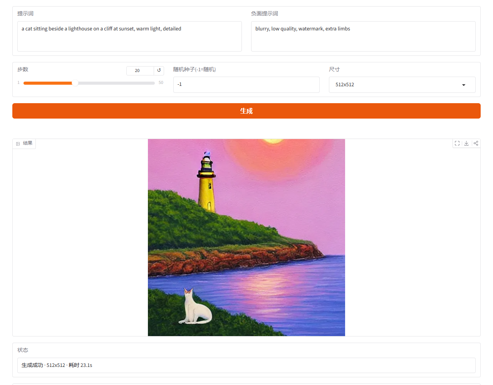
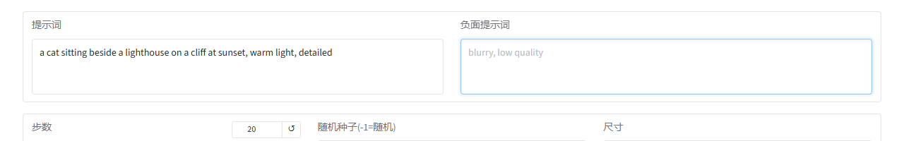
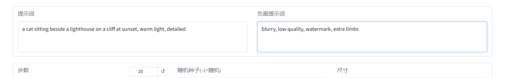

# SD15 文生图 · Intel 核显离线镜像

一个容器装好网页界面、推理引擎和管理进程，在 NAS 上离线跑 SD1.5 文生图。只用 Intel 核显，不需要 NPU，不联网拉模型。



## 先读这段

- **镜像不含模型权重**：需自行准备 `OpenVINO/stable-diffusion-v1-5-int8-ov`（约 2.2GB），目录结构见下。
- **内存**：16GB 才能稳定出图。8GB 机型能打开网页、能加载模型，但会被内存保护拦下，**不建议部署**。
- **架构**：x86_64（amd64），ARM 机型暂不支持。

## 获取镜像

在线拉取（推荐）：

```bash
docker pull mingmate/sd15-one-gpu:2026-11-08
```

Docker Hub 页面：https://hub.docker.com/r/mingmate/sd15-one-gpu

国内网络不稳时，用本仓库 Releases 里的 `sd15-one-gpu_2026-11-08.tar` 离线导入：

```bash
docker load -i sd15-one-gpu_2026-11-08.tar
```

导入后的镜像名是 `sd15-one-gpu:local`，把下面命令里的镜像名换成它即可。

## 部署

1. 把模型放好（结构必须一致）：

   ```
   <模型基目录>/config.json                              ← 0 字节空文件
   <模型基目录>/OpenVINO/stable-diffusion-v1-5-int8-ov/  ← 25 个模型文件
   ```

2. 用仓库里的 [`compose.registry.gpu.yaml`](compose.registry.gpu.yaml) 起服务，或直接用：

   ```bash
   docker run -d --name SD15-One-GPU \
     --restart unless-stopped \
     -p 7860:7860 \
     --add-host host.docker.internal:host-gateway \
     -v <模型基目录>:/models:ro \
     -v <state.json 文件>:/tmp/sd_one_state.json \
     --device /dev/dri:/dev/dri \
     mingmate/sd15-one-gpu:2026-11-08
   ```

   四样别漏：宿主机名映射、模型卷只读挂载、`state.json` 必须是文件（不能是目录）、`/dev/dri` 透传；**不要设 mem_limit**。

3. 浏览器打开 `http://<NAS 地址>:7860`。

网页标题是「SD15 · 文生图（本地 Intel 核显，模型离线）」，推理后端只有 GPU 一项。如果状态区提示模型加载失败，先检查第 1 步的目录和文件是否齐全。

## 运行演示

正向提示词 → 负面提示词 → 点生成，512×512、20 步、GPU 约 23 秒出图。






## 许可与署名

- 整合代码：MIT + 附加保护条款（署名保留、禁止商用等）→ [`LICENSE.txt`](LICENSE.txt)
- 模型权重：CreativeML Open RAIL-M → [`LICENSE-MODEL-OpenRAIL-M.txt`](LICENSE-MODEL-OpenRAIL-M.txt)
- 框架：Gradio / OpenVINO Model Server / OpenVINO（Apache-2.0）
- 部署整合：很多问题的小明同学 · https://github.com/gulugulupao/
